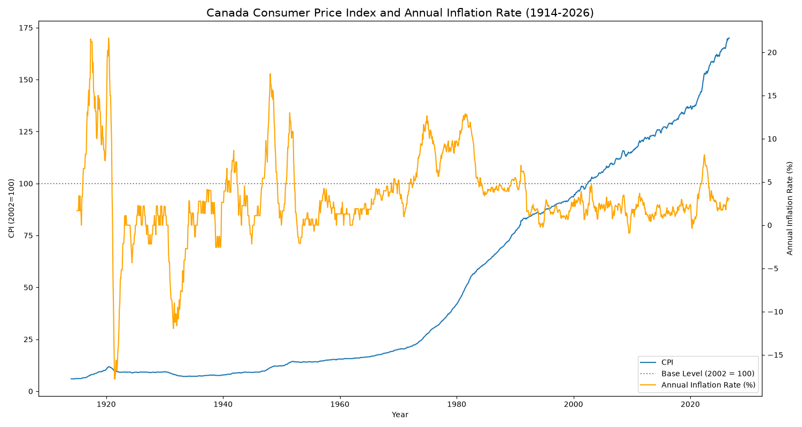

# FINE3300 Assignment 2: CPI Inflation Calculator
 
## Overview
This repository contains my FINE3300 Assignment 2. The assignment includes a Python inflation calculator that uses the Bank of Canada's monthly Consumer Price Index (CPI) data to replicate the [Bank of Canada Inflation Calculator](https://www.bankofcanada.ca/rates/related/inflation-calculator/), and a separate program that graphs the CPI and its annual percentage change from 1914 to 2026.
 
The Bank of Canada's calculator only lets users enter a year, even though the CPI data is recorded monthly. I enhanced the calculator so that users enter a full date (month and year) for each period, which allows for more precise comparisons.
 
The project is split into two programs so each part is easier to follow:
- **`InflationCalculator.py`** uses a class called `InflationCalculator` to read the data and calculate the results.
- **`CPI_Annual_Inflation_Percentage_Change_Graph.py`** uses a class called `CPIGraph` to read the data and create the graph.
## Files
1. `InflationCalculator.py` : The inflation calculator program
2. `CPI_Annual_Inflation_Percentage_Change_Graph.py` : The program that creates and saves the CPI graph
3. `STATIC_INFLATIONCALC.csv` : Bank of Canada monthly CPI data (1914-01 to 2026-09), downloaded in CSV format from the Inflation Calculator page
4. `CPI_and_Annual_Inflation_Graph.png` : The CPI graph created by `CPI_Annual_Inflation_Percentage_Change_Graph.py`
5. `README.md` : This write-up
## How It Works
 
### Reading the Data (both programs)
Both classes read the Bank of Canada CPI file into a Pandas data frame. The first 8 lines of the file are notes from the Bank of Canada rather than data, so they are skipped. Only rows dated the 1st of each month are kept (see Data Notes below). The data frame is stored as a private member so it can only be accessed through the class's methods.
 
### Program 1: The InflationCalculator Class
 
#### The get_cpi and is_valid_date methods
The `get_cpi` method takes a month and year, builds a date in the same format as the data file (e.g. `2002-01-01`), filters the data frame down to that row and returns the CPI value. The `is_valid_date` method checks whether a date entered by the user exists in the data set, which confirms that the date is both in the correct format and within the data range.
 
#### The calculate_inflation method
This method uses the CPI for both dates to produce the same results as the Bank of Canada calculator, using the same equations shown on the Bank of Canada's website:
- **Equivalent cost:** Cost₂ = Cost₁ × (CPI₂ / CPI₁)
- **Percentage change:** ((Cost₂ − Cost₁) / Cost₁) × 100
- **Number of years:** the total number of months between the two dates divided by 12 (e.g. January 2020 to July 2022 is 2.5 years)
- **Average annual rate of inflation:** found by solving CPI₂ = CPI₁ × (1 + rate)^years for the rate
All of the results are returned in a dictionary so each value can be accessed by name.
 
#### User Input and Validation
The program starts with a short introduction and instructions. Outside of the class, the `get_cost` and `get_date` functions prompt the user for the cost and the two dates. Both functions keep asking until a valid input is entered:
- **Cost:** dollar signs, commas and spaces are accepted (e.g. `$1,234.56` or `1 000`). Letters, symbols, more than one decimal point, zero and negative numbers are rejected.
- **Dates:** must be entered as `YYYY-MM` and must be between `1914-01` and `2026-09`. The month and year are then extracted from the date.
- The two dates cannot be the same, since the number of years would be zero.
### Program 2: The CPIGraph Class
 
#### The plot_cpi method
This method uses Matplotlib to graph the CPI on the left axis and the annual inflation rate (the annual percentage change in CPI) on the right axis, with a dotted line through the base level. The annual percentage change compares each month to the same month one year earlier. It also uses NumPy to calculate the average annual inflation rate over the whole data set. The graph is saved as `CPI_and_Annual_Inflation_Graph.png`.
 
## How to Run
1. Clone this repository
2. Install the required libraries: `pip install numpy pandas matplotlib`
3. Open the folder in Visual Studio Code
**To use the inflation calculator:**
 
4. Run `InflationCalculator.py`
5. Enter the cost, then the first and second dates in the format `YYYY-MM` when prompted
Dates can be entered in either order. If the second date is before the first, the percentage change, number of years and annual rate are negative, the same as the Bank of Canada calculator.
 
**To create the graph:**
 
6. Run `CPI_Annual_Inflation_Percentage_Change_Graph.py`
7. The average annual inflation rate is printed, the graph is saved as `CPI_and_Annual_Inflation_Graph.png`, and the graph opens in a new window. Close the window to end the program.
Make sure `STATIC_INFLATIONCALC.csv` is in the same folder as both programs.
 
## CPI Graph

 
### Commentary
The blue CPI line shows the overall price level, while the orange line shows how quickly prices were changing at each point in time. The most useful insight comes from reading them together: the CPI line rises steeply whenever the orange line stays high for several years in a row, such as in the 1970s and early 1980s, and flattens out when the orange line is near or below zero.
 
The graph also shows that inflation has become much more stable over time. Before the 1950s, the orange line swings sharply in both directions, with large spikes around both World Wars and periods of deflation (when prices actually fell) after World War I and during the Great Depression. Since the early 1990s, when the Bank of Canada began targeting inflation, it has stayed in a much narrower range around 2%, with the post-pandemic spike in 2022 as the main exception.
 
The dotted line marks the base level, where the CPI equals 100. Since 2002 is the base year, the blue line crosses it around 2002. Prices to the left of that point are lower than 2002 prices, and prices to the right are higher.
 
Using NumPy, the average annual inflation rate across the whole data set is about 3.13%. This is higher than the roughly 2% seen in recent decades because of the large swings in the early years.
 
**Output from `CPI_Annual_Inflation_Percentage_Change_Graph.py`:**
```
Average annual inflation rate (1915-2026): 3.13%
```
 
## Sample Output from the Inflation Calculator
**Example 1: $100 from September 2002 to September 2025**
```
This is a CPI Inflation Calculator
It allows you to find out the value of an amount of money in one month and year compared to another month and year,
using the Bank of Canada's monthly Consumer Price Index (CPI) data.
 
Instructions:
- Enter the cost in Canadian dollars (e.g. 100, $1,250.50 or 1 000)
- Enter each date as YYYY-MM (e.g. 2002-09), between 1914-01 and 2026-09
- Dates can be entered in either order
 
Enter the cost of the goods or services: 100
Enter the first date (YYYY-MM): 2002-09
Enter the second date (YYYY-MM): 2025-09
 
Results
$100.00 CAD in 2002-09 is equivalent to $163.43 CAD in 2025-09
Percentage change: 63.43%
Number of years: 23.00
Average annual rate of inflation: 2.16%
CPI in first period: 100.9
CPI in second period: 164.9
2002 CPI = 100.0
```
 
**Example 2: the same dates in reverse (going back in time)**
```
Enter the cost of the goods or services: 100
Enter the first date (YYYY-MM): 2025-09
Enter the second date (YYYY-MM): 2002-09
 
Results
$100.00 CAD in 2025-09 is equivalent to $61.19 CAD in 2002-09
Percentage change: -38.81%
Number of years: -23.00
Average annual rate of inflation: -2.11%
CPI in first period: 164.9
CPI in second period: 100.9
2002 CPI = 100.0
```
 
**Example 3: input validation**
```
Enter the cost of the goods or services: abc
Invalid input. Please enter a valid number.
Enter the cost of the goods or services: 0
Invalid input. The cost must be greater than zero.
Enter the cost of the goods or services: $1,250.50
Enter the first date (YYYY-MM): 2002/01
Invalid date. Please use the format YYYY-MM, between 1914-01 and 2026-09.
Enter the first date (YYYY-MM): 1900-01
Invalid date. Please use the format YYYY-MM, between 1914-01 and 2026-09.
Enter the first date (YYYY-MM): 2002-01
Enter the second date (YYYY-MM): 2002-01
The second date must be different from the first date.
Enter the second date (YYYY-MM): 2026-09
 
Results
$1,250.50 CAD in 2002-01 is equivalent to $2,178.12 CAD in 2026-09
Percentage change: 74.18%
Number of years: 24.67
Average annual rate of inflation: 2.28%
CPI in first period: 97.6
CPI in second period: 170.0
2002 CPI = 100.0
```
(Examples 2 and 3 start with the same introduction and instructions as Example 1, which are left out above to keep them short.)
 
## Data Notes
- The CSV file begins with 8 lines of Bank of Canada notes (terms and conditions and the series description) before the data, so these lines are skipped when reading the file.
- The data is monthly and recorded on the 1st of each month. The file contains two irregular entries (1927-04-30 and 1932-04-30), which were excluded so that each month appears only once. This matters for the graph, since the annual percentage change compares each month to the row 12 positions earlier.
## References
- Bank of Canada, [Inflation Calculator](https://www.bankofcanada.ca/rates/related/inflation-calculator/) (data source and equations)
- Bank of Canada, [Understanding the consumer price index](https://www.bankofcanada.ca/2021/05/understanding-consumer-price-index/)
- Statistics Canada, [Consumer price indexes](https://www.statcan.gc.ca/en/subjects-start/prices_and_price_indexes/consumer_price_indexes)
- Pandas documentation, [read_csv](https://pandas.pydata.org/docs/reference/api/pandas.read_csv.html) (used `skiprows` to skip the Bank of Canada notes at the top of the file)
- Pandas documentation, [to_datetime](https://pandas.pydata.org/docs/reference/api/pandas.to_datetime.html) (converts the date column to real dates for the graph's x-axis)
- Pandas documentation, [pct_change](https://pandas.pydata.org/docs/reference/api/pandas.DataFrame.pct_change.html) (calculates the annual percentage change)
- Matplotlib documentation, [twinx](https://matplotlib.org/stable/api/_as_gen/matplotlib.axes.Axes.twinx.html) (creates the right-hand axis)
- Matplotlib documentation, [axhline](https://matplotlib.org/stable/api/_as_gen/matplotlib.axes.Axes.axhline.html) (draws the dotted base level line)
- Matplotlib documentation, [get_legend_handles_labels](https://matplotlib.org/stable/api/_as_gen/matplotlib.axes.Axes.get_legend_handles_labels.html) (combines the legends from both axes)
- Matplotlib documentation, [Color Demo](https://matplotlib.org/stable/gallery/color/color_demo.html) (line colours)
- W3Schools, [Python abs() Function](https://www.w3schools.com/python/ref_func_abs.asp) (used in the average annual rate calculation)
 